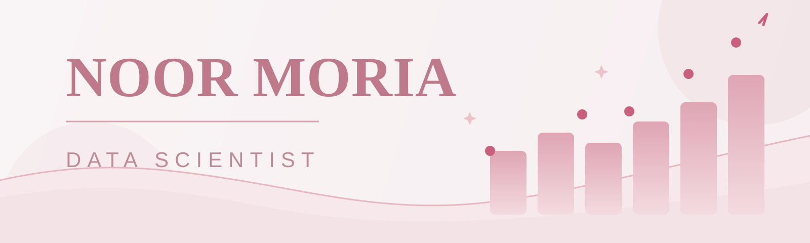

  

<h1 align="center">Hello! I'm Noor 👋</h1>

  <b>Data Scientist</b> 
  University of Jeddah

  I’m interested in <b>data analysis, machine learning, and practical digital solutions</b>.

---

## 🛠 Skills

### 💻 Programming languages

  
  

### 📊 Data analysis & visualization

  
  
  
  

### 🤖 Data science & AI

  
  

## 🧰 Tools

### Databases

  

### Coding environments

  
  
  

### Platforms & version control

  
  
  

### AI assistants

  

## 📌 Projects
| Project | Description |
| --- | --- |
| [Navigate](https://github.com/noormoria/navigate) | A customer retention project focused on churn risk analysis and retention prioritization. |
| [Finora](https://github.com/noormoria/finora) | A financial tool designed to analyze numbers and support accounting tasks. |
| More projects coming soon | I’m continuously building more projects as I learn and improve. |

## 📫 Connect with me

  

