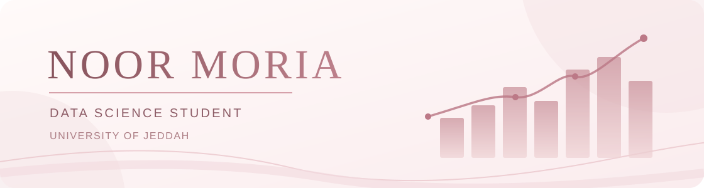

  

<h2 align="center">Hi, I'm Noor! 👋</h2>

  <b>Data Science Student | Data Analytics · Machine Learning · Web Development</b>

  Exploring data, building practical tools, and turning ideas into meaningful digital experiences.

  <a href="https://www.linkedin.com/in/noor-moria-513284369/">LinkedIn</a>
  &nbsp;·&nbsp;
  <a href="https://github.com/noormoria?tab=repositories">My Repositories</a>

---

### About Me

- 🎓 Data Science student at **University of Jeddah**, Saudi Arabia.
- 📊 Interested in **data analytics, machine learning, and data visualization**.
- 💻 Enjoy building **data-driven applications and web tools**.
- 🌱 Continuously learning through hands-on projects.

### Technical Skills

| Area | Technologies & Tools |
| --- | --- |
| **Programming** | Python, R, SQL, JavaScript, HTML, CSS |
| **Data Science** | pandas, NumPy, scikit-learn, Matplotlib |
| **Analytics & Visualization** | Power BI, Excel |
| **Development** | Streamlit, Git, GitHub, Google Colab |

### Selected Projects

**[Navigate — Customer Retention Intelligence](https://github.com/noormoria/navigate)**  
A customer retention tool focused on churn risk analysis and retention prioritization.

**[Finora — Financial Tools](https://github.com/noormoria/finora)**  
Practical tools for calculating, analyzing, and understanding accounting and financial figures.

---

  Thanks for visiting my profile. Let's connect and keep learning!

